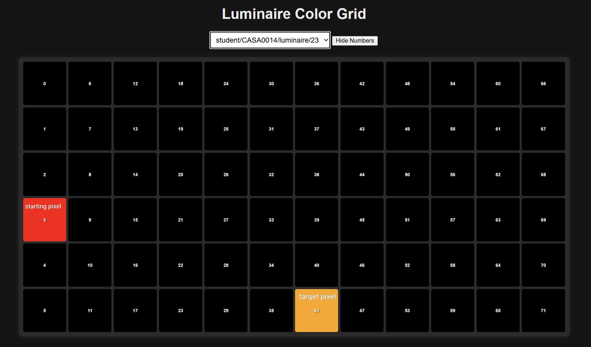
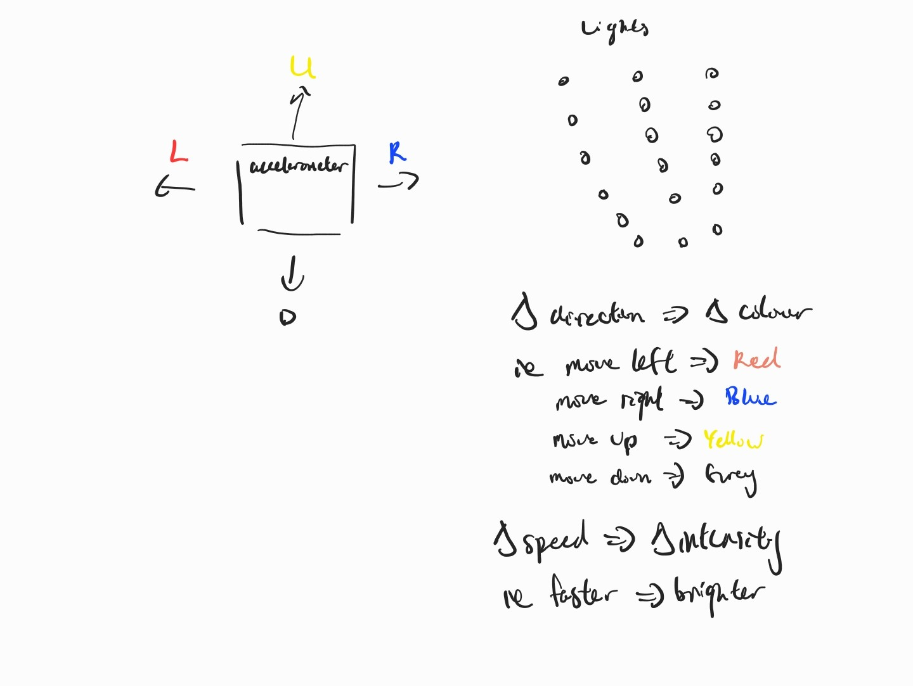
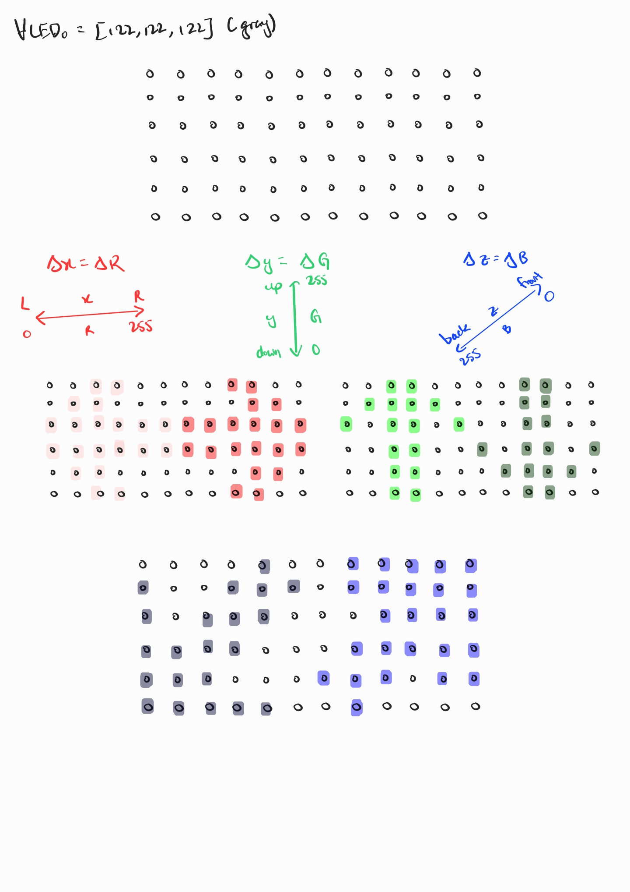
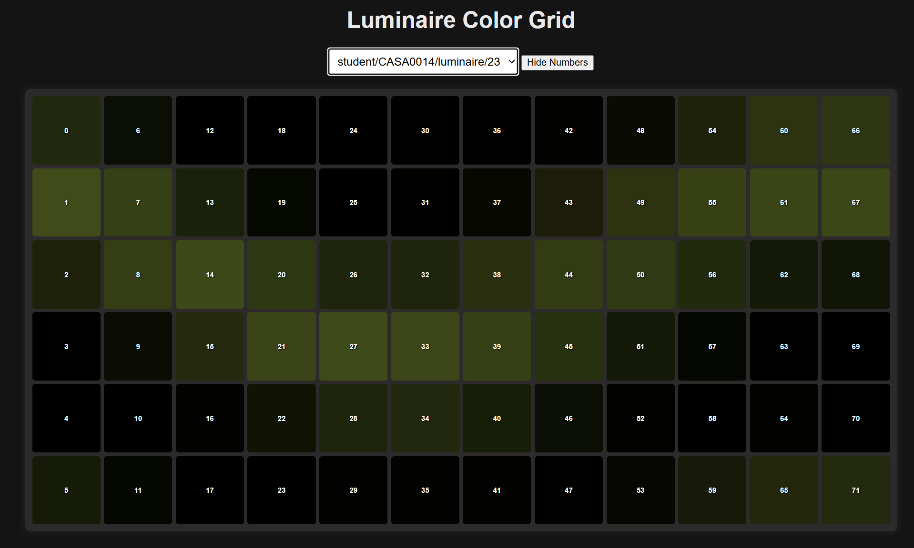
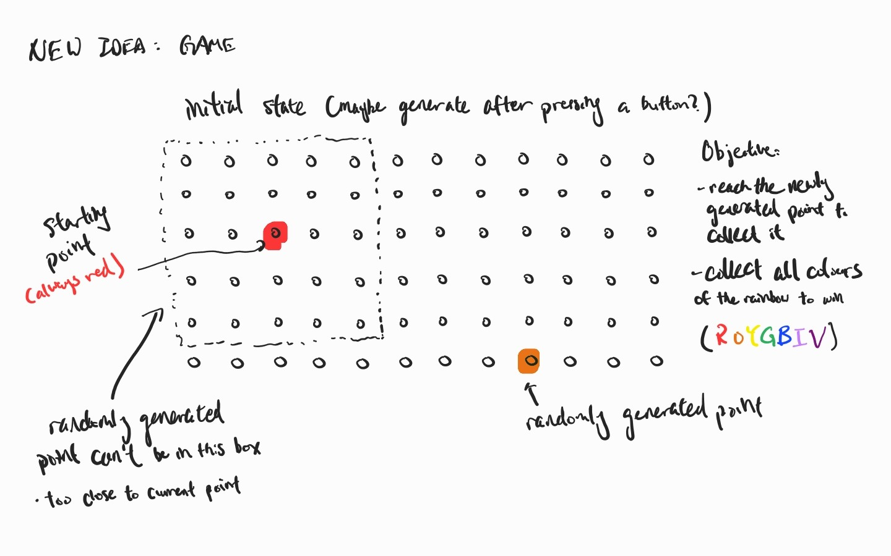
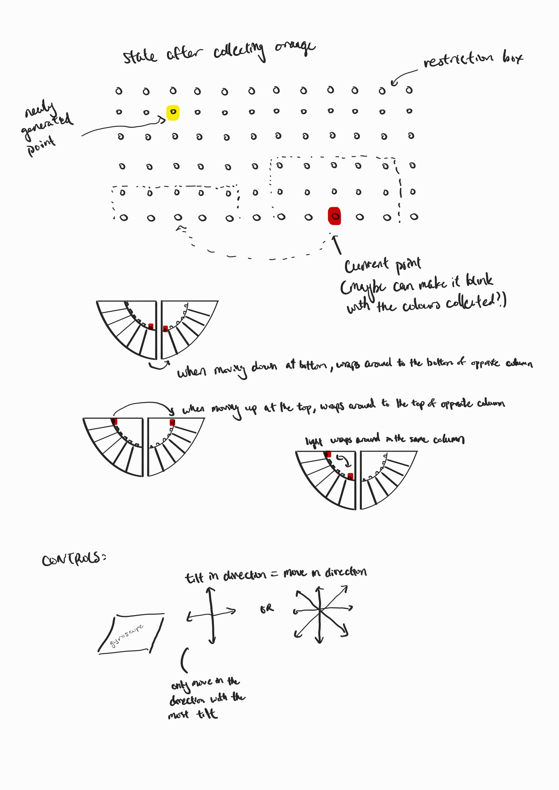
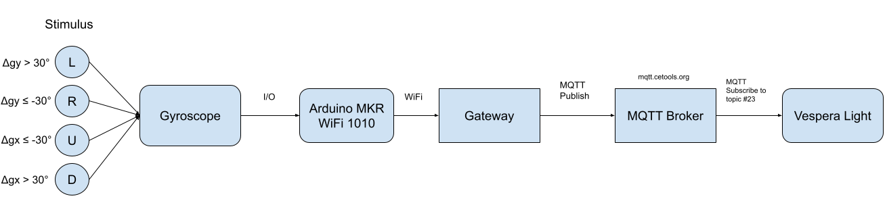
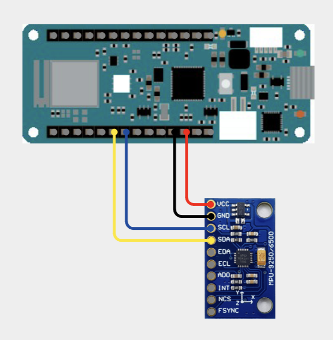

# CASA0014 - Vespera Coursework

"Snake"-like game on the Vespera where the movement of the starting pixel is controlled by a gyroscope.



## Contents

- [Ideation](#ideation)
- [System Overview](#system-overview)
- [Components](#components)
- [Wiring](#wiring)
- [Repository Structure](#repository-structure)
- [Replication Steps](#replication-steps)
- [Operational Notes](#operational-notes)
- [References](#references)

## Ideation

The sensor that I chose to use for this project was the accelerometer because it was the sensor that I was most interested in learning to use and wanted to incorporate in projects that I would work on in this course.

### Idea 1

The first idea was to simply change the RGB values of the light based on the movement of the accelerometer. Some ideas that came to mind were to change the R or G or B values individually based on the change in direction of the accelerometer or change the brightness of the light based on the speed that the accelerometer was moving at (as shown in the sketches).





After testing with several ideas where the movement of the sensor changed the lights, I was dissatisfied with the way it looked as the accelerometer is quite sensitive so small movements would cause large changes that were hard to control, alongside the fact that the colours produced were not very visually appealing.



### Idea 2

Idea 1 did not give a satisfying result, so I thought about a different approach for the usage of the accelerometer.\
Idea 2 takes inspiration from the classic Snake game where the accelerometer acts as a game controller, and its tilt decides which way the player's pixel moves along the light. The player starts off as the red pixel and a target pixel appears at a random position in the next colour of the rainbow (orange). The player captures it by moving onto it and the next colour then appears in another random position. Unlike the classic Snake game, the pixel does not grow in length as it captures its targets. The goal of the game is to collect all the colours of the rainbow (ROYGBIV).





## System Overview



## Components

| Component | Quantity |
| --- | --- |
| Arduino MKR WiFi 1010 | 1 |
| MPU 9250/6500 | 1 |
| Breadboard | 1 |
| Wires | 4 |
| LIPO Battery | 1 |
| Cardboard enclosure | 1 |

## Wiring

| MPU 9250/6500 pin | Arduino pin |
| --- | --- |
| VCC | VCC |
| GND | GND |
| SCL | SCL |
| SDA | SDA |



## Repository Structure

```md
README.md
mqtt_vespera/
  connections.ino           # Helper functions to connect to WiFi and the MQTT broker
  imu.ino                   # Helper functions to read the data from the gyroscope
  mqtt_vespera.ino          # Main program file
  normalizer.ino            # Helper functions to normalize the raw data read
  RGBLed.ino                # Helper functions to change the LEDs to R/G/B
img/                        Sketches, photos, diagrams
.gitignore
```

## Replication Steps

1. Connect the MPU 9250/6500 to the Arduino MKR WiFi 1010 in the configuration shown above.
2. Connect the Arduino to a computer with a USB cable.
3. Clone or download this repository.
4. Install the required libraries (Tools > Manage Libraries):
   - PubSubClient (version 2.8)
   - WiFiNINA (version 2.1.1)
5. Create an `arduino_secrets.h` file and enter your Wi-Fi and MQTT details in the following format:

   ```c++
   #define SECRET_SSID "your_wifi_network"
   #define SECRET_PASS "your_wifi_password"
   #define SECRET_MQTTUSER "mqtt_username"
   #define SECRET_MQTTPASS "mqtt_password"
   ```

6. Open `mqtt_vespera/mqtt_vespera.ino`, select the correct board and port, then upload.
7. Open the Serial Monitor (115200 baud) to confirm it connects.
8. Once the connection is made, unplug the USB cable and connect a battery to the Arduino for easier movement.
9. Rotate the gyroscope and see if the starting pixel moves in the same direction.

## Operational Notes

- Make sure that the accelerometer is facing the right direction, where the pins are on the left and the VCC pin is furthest away from you and the component side is facing up, in order to have the pixel light move in the same direction as the tilt of the sensor.
- Complete each tilt until the controller is back at a neutral position for the sensor to more accurately read the next movement.

## References

- Code for reading MPU9250 Sensors with Arduino code by HiBit (<https://github.com/hibit-dev/mpu9250/tree/master>)  
- Vespera Simple Sweep Code and code for MQTT connection by Duncan Wilson (<https://github.com/ucl-casa-ce/casa0014/tree/main/vespera/workshop-sketch/mkr1010_mqtt_simple_random>)  
- Wiring Diagram (<https://app.cirkitdesigner.com/project>)